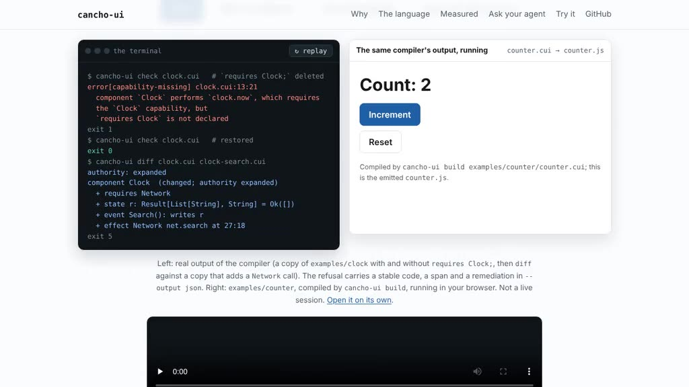

# cancho-ui

**A UI language whose compiler knows what each component is allowed to do.**

Most UI stacks let a component reach the network, the clock or storage through
an import, and leave you to find out by reading. In cancho-ui a component
declares the authority it needs, and the compiler refuses the program when the
declaration and the code disagree. It builds JavaScript and DOM, and reports
its findings as data an agent can read.

```
$ cancho-ui check clock.cui          # `requires Clock;` deleted
error[capability-missing] at clock.cui:13:21: component `Clock` performs `clock.now`
  which requires the `Clock` capability, but `requires Clock` is not declared
$ echo $?
1
$ cancho-ui check examples/clock/clock.cui
$ echo $?
0
```

[](docs/demo/ui-demo.mp4)
*A 20-second recording of the project page's demo (real compiler output beside the compiled counter running), not a live session. Re-record it with `node scripts/record-demo.js` (needs `playwright` and `ffmpeg`).*

- **Authority is declared and checked.** `requires Clock;` is the only way
  `clock.now()` is reachable. A missing declaration is `capability-missing`; a
  declaration nothing uses is `capability-unused`. The rule is cancho's
  exact-row rule for effects, lifted to the UI. `Storage` (`storage.get`, `storage.set`) and `net.get`
  (a same-origin `fetch`) are real adapters, and `json.get` / `json.items` take a fetched document apart: [`docs/adapters.md`](docs/adapters.md). `start Event;` and `every N Event;` refresh a page without a button: [`docs/schedules.md`](docs/schedules.md).
- **Diagnostics are data.** `--output json` gives a locked shape with a stable
  `code`, a source span and a remediation. Consumers match on the code, not on
  the prose ([`spec/diagnostics`](spec/diagnostics/README.md)).
- **Ask the compiler, do not guess.** `inspect effects` lists the capabilities a
  component declares and every reachable effect that needs one, with its span.
  `report` separates what was checked from what is a trust boundary.
- **Review the change, not the text.** `diff base.cui candidate.cui` says
  `authority: expanded` when a component gained a capability, and lists the
  state, events, handler writes and effects that moved. Line shifts, comments
  and reordering are not changes. It compares the categories listed in
  `not_compared`, not full behavioural equivalence.
- **Replay the adverse ordering, no browser.** `test prog.cui trace.json`
  runs a JSON trace of events, scripted `net.search` answers and fake-clock
  ticks over the typed IR and checks the state after each step. A slow earlier
  request resolving after a newer one must be dropped; the trace says so in 25
  lines and fails, with a located error and exit 4, if the runtime rule is
  removed. It replays handlers, not the view, timing or the real network, and it
  is a second implementation of the semantics, not the emitted JavaScript
  ([`docs/replay.md`](docs/replay.md)).
- **Async that cannot go stale.** A request that finishes after a newer one is
  dropped at the `await`, and a disposed component receives `Cancelled` in its
  own mandatory `match` arm.
- **No virtual DOM, no JSX, no macros, no implicit anything.** The view is data
  lowered one-to-one to DOM calls; the page owns presentation.
- **Measured.** 10 example programs compile and run (a counter, a clock, a
  searchable list with cancellation, composed components, cross-file imports);
  150 tests pass (35 of them for `diff`, 35 for `test`); and a mutation test runs the front end on every prefix and
  every one-character deletion of the examples (about 26,000 programs) without
  a panic. Not measured: whether an agent is more productive with cancho-ui
  than with a conventional stack. That needs the Phase 3 benchmark, which has
  not been run, and there is no mobile backend yet.

**[Project page](https://alpibrusl.github.io/cancho-ui)** ·
[Language design](docs/language-design.md) ·
[Semantics](docs/semantics.md) ·
[Security model](docs/security-model.md) ·
[Roadmap](ROADMAP.md)

## Try it

**Claude Code skill:** copy [`skills/cancho-ui`](skills/cancho-ui/SKILL.md) into `~/.claude/skills/` (or your project's `.claude/skills/`) and the agent knows how to check, inspect and diff `.cui` programs, with the rules built in. Other agents can read the same file as plain instructions.

**Or ask your coding agent to do it:** paste [`docs/agent-prompt.md`](docs/agent-prompt.md) into Claude Code, Codex or similar. It installs cancho-ui, proves the install with the test suite (no network, no key, no model), and walks through a refusal and a `diff`.

You need a Rust toolchain (the version is pinned in `rust-toolchain.toml`).

```sh
git clone https://github.com/alpibrusl/cancho-ui.git && cd cancho-ui
cargo build --release
target/release/cancho-ui build examples/clock/clock.cui -o examples/clock/clock.js
cd examples/clock && python3 -m http.server     # then open /clock.html and click Start
```

The `python3` line only serves the page to your browser; nothing in the
compiler or the emitted code uses Python.

```sh
cancho-ui check   <file.cui>...  [--output json]
cancho-ui build   <file.cui>...  [-o <path>] [--target web] [--output json]
cancho-ui build   <file.cui> --pwa -o <dir> [--name <text>]   # an installable web app
cancho-ui inspect component|effects|ir <file.cui> [<name>] [--output json]
cancho-ui diff    <base.cui> <candidate.cui>  [--output json]
cancho-ui test    <file.cui> <trace.json>  [--output json]
cancho-ui report  <file.cui>...  [--output json]
```

Exit codes match cancho: `0` success, `1` refused with a located diagnostic,
`2` command line wrong, `3` environment failed. `diff` adds `5`: the programs
differ semantically (`0` is "no semantic change"; `1` stays "a file did not
compile"). See [`docs/semantic-diff.md`](docs/semantic-diff.md). `test` adds
`4`: a test failed (an expectation did not hold, the trace is malformed, or the
program did something replay refuses; read the `rule`). Example traces are
`examples/*/*.trace.json`; try
`cancho-ui test examples/search/search.cui examples/search/stale.trace.json`.
See [`docs/replay.md`](docs/replay.md).

```sh
cargo fmt --all --check
cargo clippy --all-targets -- -D warnings
cargo test --workspace          # the gate, the same three commands CI runs
```

## More

[Docs index](docs/README.md) · [Proposal](docs/proposal.md) ·
[IR schema](spec/ir-schema/README.md) · [Grammar](spec/grammar/README.md) ·
[Session log](SESSION-LOG.md) · [Writing cancho-ui source](AGENTS.md) ·
[Contributing](CONTRIBUTING.md)

Design lands in `docs/` before the code that implements it, and a claim that
turns out wrong is corrected in place. The compiler is written in Rust today;
following cancho's own [self-hosting note](ROADMAP.md), nothing is ported to
cancho until a program asks for it.

[EUPL-1.2](LICENSE).
